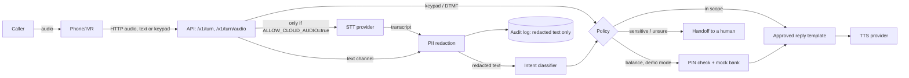

# 2. Architecture

## Invariants

1. The classifier, the logs and TTS never see raw text; they see redacted text.
2. Replies are fixed templates and never echo the caller. No personal data can reach TTS. The only dynamic value is the demo balance, which comes from the back end after PIN authentication.
3. Anything uncertain goes to a human. Two consecutive misunderstood turns trigger a handoff.
4. The raw transcript is never returned by the API.
5. A provider error (STT/TTS) returns 502; the caller of the API should route the call to a human.
6. A keyed-in PIN never appears in a reply, a log line or TTS text.

## Deployment modes

| Mode | Where audio goes | Status |
| --- | --- | --- |
| Text only | Nowhere (the IVR uses its own STT) | Works in this repo and is tested |
| Cloud STT/TTS | ElevenLabs | Works against the live service (see [first run](05-first-run.md)); needs customer approval |
| On-prem STT/TTS | Inside the institution | Not built. A new provider implementing the `SpeechProvider` interface is needed |

## Key limitation

Redaction runs **after** STT. With a cloud STT, raw audio reaches the provider before redaction can act. So if the requirement is "data cannot leave", cloud mode alone is not a solution (see the risk register, item 1).
