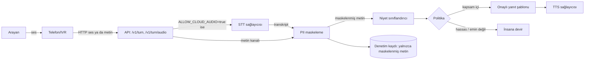

# 2. Mimari

## Değişmezler

1. Sınıflandırıcı, log ve TTS ham metni görmez; maskelenmiş metni görür.
2. Yanıtlar sabit şablondur, kullanıcının sözünü yansıtmaz. TTS'e kişisel veri gidemez.
3. Emin olunamayan her durum insana devredilir. İki ardışık anlaşılmayan turda devir.
4. Ham transkript hiçbir API yanıtında dönmez.
5. Sağlayıcı hatası (STT/TTS) 502 döner; çağıran taraf çağrıyı insana yönlendirmelidir.

## Dağıtım modları

| Mod | Ses nereye gider | Durum |
| --- | --- | --- |
| Yalnızca metin | Hiçbir yere (IVR kendi STT'sini kullanır) | Bu repoda çalışır ve test edilmiştir |
| Bulut STT/TTS | ElevenLabs'a | Kod yazıldı, istek şekilleri testlerle doğrulandı, gerçek servisle denenmedi, müşteri onayı gerekir |
| Yerel STT/TTS | Kurum içinde | Yok. `SpeechProvider` arayüzünü uygulayan yeni bir sağlayıcı yazılır |

## Önemli sınırlama

Maskeleme, STT'den **sonra** çalışır. Bulut STT kullanılırsa ham ses, maskeleme devreye girmeden sağlayıcıya ulaşır. Bu yüzden "veri çıkamaz" şartı varsa bulut modu tek başına çözüm değildir (bkz. risk tablosu, madde 1).
